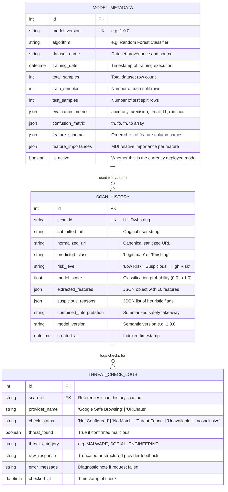

# PhishGuard AI — Database Design & Schema Specification

## 1. Overview
PhishGuard AI employs SQLite via SQLAlchemy ORM for lightweight, zero-configuration local persistence suitable for academic demonstration and reproducible local evaluation.

The database stores scan records, threat-intelligence provider logs, and trained model evaluation metadata.

---

## 2. Entity-Relationship (ER) Diagram

---

## 3. Detailed Table Specifications

### 3.1 `scan_history`
Stores primary scan results for every URL submitted through the scanner interface or API.

| Column | Type | Constraints | Description |
|---|---|---|---|
| `id` | Integer | Primary Key, Autoincrement | Internal relational identifier |
| `scan_id` | String(36) | Unique, Not Null, Index | Public UUIDv4 for URL routing and lookups |
| `submitted_url` | Text | Not Null | Verbatim input string supplied by user |
| `normalized_url` | Text | Not Null | Sanitized canonicalized URL |
| `predicted_class` | String(20) | Not Null | `Legitimate` or `Phishing` |
| `risk_level` | String(20) | Not Null | `Low Risk`, `Suspicious`, or `High Risk` |
| `model_score` | Float | Nullable | Model prediction probability (0.0 - 1.0) |
| `extracted_features` | JSON / Text | Not Null | Structured dictionary of 16 extracted lexical features |
| `suspicious_reasons` | JSON / Text | Nullable | Array of detected security anomaly explanations |
| `combined_interpretation` | Text | Not Null | Plain-language security takeaway |
| `model_version` | String(20) | Not Null | Version of model used for evaluation |
| `created_at` | DateTime | Not Null, Default `utc_now`, Index | Scan creation timestamp |

### 3.2 `threat_check_logs`
Stores the individual results of each external threat-intelligence provider query.

| Column | Type | Constraints | Description |
|---|---|---|---|
| `id` | Integer | Primary Key, Autoincrement | Record ID |
| `scan_id` | String(36) | Not Null, Index, FK -> `scan_history.scan_id` | Scan relation |
| `provider_name` | String(50) | Not Null | `Google Safe Browsing` or `URLhaus` |
| `check_status` | String(30) | Not Null | `Not Configured`, `No Match Reported`, `Threat Reported`, `Unavailable`, `Inconclusive` |
| `threat_found` | Boolean | Not Null, Default False | Boolean threat detection flag |
| `threat_category` | String(100) | Nullable | Category reported by provider |
| `raw_response` | Text | Nullable | Upstream status or detail excerpt |
| `error_message` | Text | Nullable | Diagnostic information if check failed |
| `checked_at` | DateTime | Not Null, Default `utc_now` | Timestamp of query |

### 3.3 `model_metadata`
Stores the definitive audit trail of the machine learning model training run.

| Column | Type | Constraints | Description |
|---|---|---|---|
| `id` | Integer | Primary Key, Autoincrement | Record ID |
| `model_version` | String(20) | Unique, Not Null | e.g., `1.0.0` |
| `algorithm` | String(50) | Not Null | `Random Forest Classifier` |
| `dataset_name` | String(100) | Not Null | Source name and benchmark information |
| `training_date` | DateTime | Not Null | Date of model training execution |
| `total_samples` | Integer | Not Null | Total URL samples analyzed |
| `train_samples` | Integer | Not Null | Training partition count |
| `test_samples` | Integer | Not Null | Held-out test partition count |
| `evaluation_metrics` | JSON / Text | Not Null | `{"accuracy": ..., "precision": ..., "recall": ..., "f1": ..., "roc_auc": ...}` |
| `confusion_matrix` | JSON / Text | Not Null | `{"tn": ..., "fp": ..., "fn": ..., "tp": ...}` |
| `feature_schema` | JSON / Text | Not Null | Ordered feature column names |
| `feature_importances`| JSON / Text | Nullable | Map of feature to importance percentage |
| `is_active` | Boolean | Not Null, Default True | Active deployment flag |

---

## 4. Indexing & Query Optimization
- Index on `scan_history.created_at` (DESC) enables fast temporal analytics and recent scan retrieval.
- Index on `scan_history.scan_id` enables sub-millisecond report lookup.
- Index on `threat_check_logs.scan_id` enables efficient cascading log loading.
