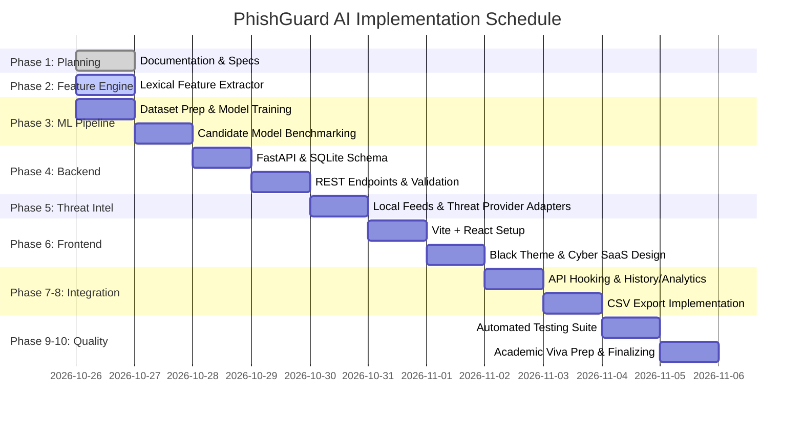

# PhishGuard AI — Implementation Roadmap

## 1. Phased Execution Matrix

---

## 2. Phase-by-Phase Deliverables

### Phase 1: Repository Inspection & Documentation First (COMPLETED)
- Inspect environment (Python 3.12, Node 24, npm 11).
- Initialize Git repository on `main`.
- Author complete system requirements, architecture, database schemas, ML methodology, threat intelligence, and roadmap documents.

### Phase 2: Feature Extraction Engine & URL Normalization
- Safe URL parser using Python standard library `urllib.parse`.
- 16 distinct lexical, structural, and semantic features.
- Zero-network extraction: pure string and syntactic analysis.
- Unit tests verifying deterministic extraction.

### Phase 3: Genuine Machine Learning Pipeline
- Benchmark dataset ingestion (curated balanced corpus of verified phishing and legitimate URLs).
- Stratified 80/20 train/test split with fixed random seed.
- Train Random Forest and Logistic Regression classifiers.
- Generate and serialize `phishguard_rf_model.joblib`.
- Record and export confusion matrix, ROC-AUC, classification report, and feature importances to `model_metadata.json`.

### Phase 4: FastAPI Backend & SQLite Database Layer
- SQLAlchemy database models (`scan_history`, `threat_check_logs`, `model_metadata`).
- Pydantic schemas for request/response serialization.
- Versioned endpoints `/api/v1/health`, `/api/v1/scan`, `/api/v1/scans`, `/api/v1/scans/{scan_id}`, `/api/v1/analytics`, `/api/v1/scans/export`, `/api/v1/model/info`.

### Phase 5: Optional Threat-Intelligence Adapters
- Cached OpenPhish and Phishing.Database local feeds.
- PhishDestroy and PhishStats server-side API adapters.
- Optional Google Safe Browsing REST v4 adapter.
- Provider status reporting and graceful degradation.

### Phase 6: Pure Black SaaS Frontend (React + Vite + TypeScript)
- Strict palette implementation:
  - Background: `#050505`, Secondary: `#0A0A0A`, Card: `#111111`, Elevated: `#181818`, Border: `#292929`.
  - Neon Green: `#39FF88`, Warning Yellow: `#FFD54A`, Danger Red: `#FF525C`.
  - Primary Text: `#F5F5F5`, Secondary Text: `#A3A3A3`.
  - **Zero Blue or Purple anywhere in DOM, CSS, SVG, or components.**
- Pages: Landing, Dedicated Scanner, Detailed Analysis Results, Analytics Dashboard, Scan History, ML Lab, Settings & About.

### Phase 7 & 8: API Integration, History, Analytics & CSV Export
- React queries hitting live FastAPI endpoints.
- Real-time Recharts visualizations using green, yellow, and red palettes.
- Paginated table with search and filtering.
- One-click CSV export of genuine scan records.

### Phase 9: Automated Testing & Security Review
- Pytest suite covering ML feature extraction, model prediction, API endpoints, threat intelligence fallbacks, database transactions, and security injection cases.
- Vitest / RTL tests for frontend forms and empty states.

### Phase 10: Academic Deliverables & Viva Preparation
- Comprehensive viva question bank (20+ detailed answers).
- Step-by-step Windows 11 execution and verification guide.
