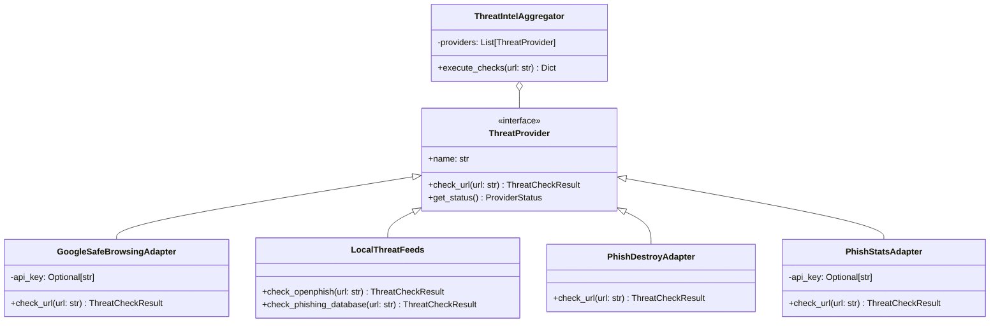

# PhishGuard AI — System Architecture

## 1. High-Level Architectural Overview

PhishGuard AI follows a modular, decoupled Client-Server architecture designed for high maintainability, strict security sandboxing, and seamless academic demonstration.

```mermaid
graph TD
    User["End User / Browser"] -->|HTTPS / HTTP| Frontend["React + Vite + TypeScript SPA"]
    
    subgraph Frontend_App["Frontend Layer (Port 5173)"]
        Landing["Landing Page"]
        Scanner["Dedicated URL Scanner"]
        Results["Detailed Analysis Report"]
        Dashboard["Analytics Dashboard"]
        History["Scan History & CSV Export"]
        MLLab["ML Lab & Model Transparency"]
        Settings["Settings & About"]
    end
    
    Frontend --> Frontend_App
    Frontend -->|REST API Calls (JSON)| BackendAPI["FastAPI Application (Port 8000)"]
    
    subgraph Backend_Layer["Backend Service Layer"]
        Router["API Router (/api/v1)"]
        Sanitizer["URL Normalizer & Validator"]
        FeatureExtractor["Feature Extraction Engine (Lexical/Structural)"]
        InferenceEngine["ML Inference Engine (Scikit-Learn Joblib)"]
        ThreatIntelService["Threat Intelligence Aggregator"]
        AnalyticsService["Database Analytics Engine"]
    end
    
    BackendAPI --> Router
    Router --> Sanitizer
    Sanitizer --> FeatureExtractor
    FeatureExtractor --> InferenceEngine
    Router --> ThreatIntelService
    Router --> AnalyticsService
    
    subgraph Persistence["Storage & Artifacts"]
        SQLite[("SQLite Database (phishguard.db)")]
        MLArtifacts["ML Model (.joblib) & Metadata (.json)"]
    end
    
    InferenceEngine --> MLArtifacts
    Router --> SQLite
    AnalyticsService --> SQLite
    
    subgraph Threat_Intelligence["Threat Intelligence Sources"]
        OpenPhish["OpenPhish local feed"]
        PhishingDatabase["Phishing.Database local feeds"]
        PhishDestroy["PhishDestroy API"]
        PhishStats["PhishStats API"]
        GSB["Google Safe Browsing v4 API"]
    end
    
    ThreatIntelService --> OpenPhish
    ThreatIntelService --> PhishingDatabase
    ThreatIntelService -.->|Server-to-Server| PhishDestroy
    ThreatIntelService -.->|Server-to-Server| PhishStats
    ThreatIntelService -.->|Optional Server-to-Server| GSB
```

---

## 2. Component Deconstruction

### 2.1 Presentation Layer (Frontend SPA)
- **Framework:** React 18 with TypeScript and Vite for near-instant HMR and fast production bundles.
- **Styling:** Tailwind CSS tailored to an uncompromising pure-black theme (`#050505` foundation, `#39FF88` green, `#FFD54A` warning yellow, `#FF525C` danger red).
- **Visualization:** Recharts customized with customized color ramps (no blue/purple default palettes).
- **Icons:** Lucide React icons.
- **Routing:** React Router v6 with seamless client-side navigation.

### 2.2 Backend Application Layer (FastAPI)
- **Framework:** FastAPI with asynchronous request handling (`async`/`await`).
- **Validation:** Pydantic models for strict request/response data typing and schema validation.
- **Endpoints:** Versioned under `/api/v1/`:
  - `GET /api/v1/health`
  - `GET /api/v1/model/info`
  - `POST /api/v1/scan`
  - `GET /api/v1/scans`
  - `GET /api/v1/scans/{scan_id}`
  - `DELETE /api/v1/scans/{scan_id}`
  - `DELETE /api/v1/scans`
  - `GET /api/v1/analytics`
  - `GET /api/v1/scans/export`
  - `GET /api/v1/threat-intelligence/status`

### 2.3 Machine Learning Pipeline Layer
- **Feature Extractor:** Identical extraction module `extract_url_features(url: str) -> dict` utilized during both batch training and real-time inference.
- **Feature Space:** 16 lexical and structural characteristics extracted strictly through offline parsing without network sockets.
- **Model Storage:** Serialized using `joblib` into `ml/artifacts/phishguard_rf_model.joblib`. Accompanying validation metrics stored in `ml/artifacts/model_metadata.json`.

### 2.4 Threat Intelligence Adapter Pattern


Each provider implements a uniform contract. If an API key is unset or external endpoints fail, the aggregator catches exceptions cleanly and sets the state (`Not Configured`, `Unavailable`, `No Match Reported`, `Threat Reported`), ensuring that ML inference never fails.

### 2.5 Security Boundary & Untrusted Processing
```
[User Input String] 
        │
        ▼
[Scheme & Syntax Validator] ──> (Invalid Scheme / Format Reject: 400 Bad Request)
        │
        ▼ (Valid http/https string)
[Lexical Parser (urllib.parse)] ──> Zero Network Outbound Calls
        │
        ▼
[Feature Matrix (1 x 16)]
        │
        ▼
[Scikit-Learn Random Forest Classifier]
        │
        ▼
[Prediction: Legitimate (0) or Phishing (1) + Confidence Score]
```
The target URL is never resolved via DNS, never pinged, and never fetched. This guarantees complete protection against Server-Side Request Forgery (SSRF) and malicious payload delivery.
