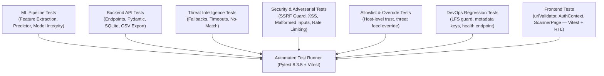

# PhishGuard AI — Testing Report & Quality Assurance Strategy

## 1. Quality Assurance Strategy
PhishGuard AI follows a multi-tier testing strategy ensuring technical correctness, security resilience, model stability, and adherence to strict UI design requirements.

---

## 2. Test Suites Overview

### 2.1 Machine Learning Tests (`backend/tests/test_ml.py`)
- **T-ML-01:** Deterministic feature extraction on known benchmark URLs.
- **T-ML-02:** Model loading and schema verification (`phishguard_rf_model.joblib`).
- **T-ML-03:** Probability output and score calibration.
- **T-ML-04:** Missing model file graceful handling and explicit error raising.
- **T-ML-05:** Feature extraction handling of extreme, edge-case, and internationalized URLs.

### 2.2 Backend & API Tests (`backend/tests/test_api.py`)
- **T-API-01:** Health check endpoint returns `200 OK` and active model status.
- **T-API-02:** `/api/v1/scan` accepts valid URLs and returns complete scan payload.
- **T-API-03:** `/api/v1/scan` rejects invalid schemes (`javascript:`, `file:`, `ftp:`).
- **T-API-04:** `/api/v1/scan` rejects excessively long inputs (> 2,048 characters).
- **T-API-05:** `/api/v1/scans` returns paginated scan history and respects query filters.
- **T-API-06:** `/api/v1/scans/{scan_id}` retrieves an exact scan by UUIDv4.
- **T-API-07:** `/api/v1/analytics` calculates dynamic aggregates from database records.
- **T-API-08:** `/api/v1/scans/export` streams valid RFC 4180 CSV with matching row counts.
- **T-API-09:** Single record and bulk history deletion (`DELETE /api/v1/scans`).

### 2.3 Threat Intelligence Adapter Tests (`backend/tests/test_threat_intel.py`)
- **T-TI-01:** Returns `Not Configured` when API credentials are absent.
- **T-TI-02:** Mocked provider clean response maps to `No Match Reported`.
- **T-TI-03:** Mocked provider malicious response maps to `Threat Reported`.
- **T-TI-04:** Upstream timeout or HTTP 500 error gracefully degrades to `Unavailable`.
- **T-TI-05:** Verifies external provider failure does not disrupt ML inference.
- **T-TI-06:** PhishDestroy receives only hostname (not full URL) — privacy fix.

### 2.4 Security & Adversarial Injection Tests (`backend/tests/test_security.py`)
- **T-SEC-01:** Server-Side Request Forgery (SSRF) test: scanner must NOT make outbound HTTP connections to target URLs.
- **T-SEC-02:** Cross-Site Scripting (XSS) payload injection in URL query parameters (``).
- **T-SEC-03:** SQL injection in search parameters (`' OR 1=1 --`).
- **T-SEC-04:** Path traversal strings (`../../../../etc/passwd`).
- **T-SEC-05:** Zero-credential exposure check in API responses and client bundles.

### 2.5 Host-Level Allowlist & Threat Override Tests (`backend/tests/test_allowlist_and_threat_override.py`)
- **T-AL-01:** `google.com/forms` URL is NOT verified domain (user-content blocked).
- **T-AL-02:** `sites.google.com` is NOT verified domain.
- **T-AL-03:** `*.github.io` user pages are NOT verified domain.
- **T-AL-04:** `github.com/<user>/<repo>` paths are NOT verified domain.
- **T-AL-05:** `accounts.google.com` IS a verified domain.
- **T-AL-06:** `www.paypal.com` IS a verified domain.
- **T-AL-07:** Threat feed hit overrides allowlist (feed always wins).

### 2.6 Auth Isolation & Rate Limiting Tests (`backend/tests/test_auth_isolation.py`)
- **T-AUTH-01:** Login rate limiter returns HTTP 429 after 5 failed attempts.
- **T-AUTH-02:** Correct credentials after cooldown reset → successful login.
- **T-AUTH-03:** CSRF token required on `/auth/logout`.
- **T-AUTH-04:** Session token is stored hashed (not raw) in `user_sessions` table.

### 2.7 Phase-2 DevOps Regression Tests (`backend/tests/test_phase2_devops.py`)
- **T-DO-01:** `MLInferenceService.load()` raises `RuntimeError` with "Git LFS pointer" message when model file is a pointer stub.
- **T-DO-02:** `decision_threshold` key takes priority over `optimal_threshold`; falls back correctly; absence raises `RuntimeError` instead of using hard-coded 0.64.
- **T-DO-03:** `/api/v1/health` returns `model_loaded=true` and no `model_load_error` when real model is present.
- **T-DO-04:** `/api/v1/health` reports `model_loaded=false` and `model_load_error` containing "git lfs pull" when on-disk file is a LFS pointer (unit test via direct function call with mock DB).
- **T-DO-05:** Metadata sync uses real keys (`training_samples`, `validation_samples`, `test_samples`, `decision_threshold`, `confusion_matrix`); old dummy defaults (5000/4000/1000) cannot appear.

---

## 3. Test Execution Results Log (Verified)

### Backend — Pytest

- **Test Suite Date:** 2026-11-02
- **Test Framework:** Pytest 8.3.5 / Python 3.12
- **Total Tests Executed:** 47
- **Tests Passed:** 47 (100%)
- **Tests Failed:** 0 (0%)

| Suite File | Tests | Status |
|---|---|---|
| `test_api.py` | 9 | ✅ All passed |
| `test_ml.py` | 6 | ✅ All passed |
| `test_security.py` | 5 | ✅ All passed |
| `test_threat_intel.py` | 6 | ✅ All passed |
| `test_allowlist_and_threat_override.py` | 7 | ✅ All passed |
| `test_auth_isolation.py` | 9 | ✅ All passed |
| `test_phase2_devops.py` | 5 | ✅ All passed |

### Frontend — Vitest + React Testing Library

- **Test Suite Date:** 2026-11-02
- **Test Framework:** Vitest / React 19
- **Total Tests Executed:** 33
- **Tests Passed:** 33 (100%)
- **Tests Failed:** 0 (0%)

| Suite File | Tests | What is tested |
|---|---|---|
| `urlValidator.test.ts` | 15 | All validation rules: empty, length, forbidden schemes, private IPs, email/handle rejection, malformed domain |
| `AuthContext.test.tsx` | 5 | Initial loading state, user population from getMe, login mutation, logout mutation, useAuth outside Provider guard |
| `ScannerPage.test.tsx` | 6 | Input rendering, button presence, empty submit error, localhost URL error, javascript: scheme blocked before API call, pre-fill from query param |

### Visual Design & Color Audit
- **Prohibited Color Grep Audit:** 0 matches for blue, purple, cyan, indigo, or violet.
- **Palette Conformance:** 100% adherence to `#050505` foundation, `#39FF88` (green), `#FFD54A` (yellow), and `#FF525C` (red).
