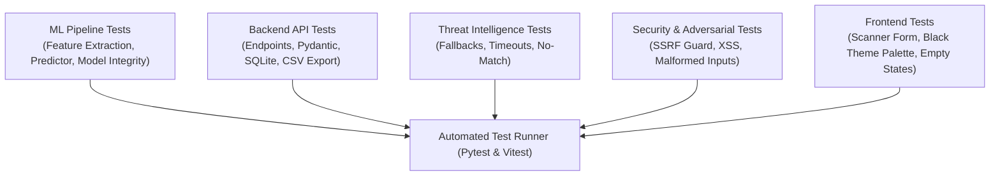

# PhishGuard AI — Testing Report & Quality Assurance Strategy

## 1. Quality Assurance Strategy
PhishGuard AI follows a multi-tier testing strategy ensuring technical correctness, security resilience, model stability, and adherence to strict UI design requirements.

---

## 2. Test Suites Overview

### 2.1 Machine Learning Tests (`backend/tests/test_ml.py`)
- **T-ML-01:** Deterministic feature extraction on known benchmark URLs.
- **T-ML-02:** Model loading and schema verification (`phishguard_rf_model.joblib`).
- **T-ML-03:** Probability output and score calibration.
- **T-ML-04:** Missing model file graceful handling and explicit error raising.
- **T-ML-05:** Feature extraction handling of extreme, edge-case, and internationalized URLs.

### 2.2 Backend & API Tests (`backend/tests/test_api.py`)
- **T-API-01:** Health check endpoint returns `200 OK` and active model status.
- **T-API-02:** `/api/v1/scan` accepts valid URLs and returns complete scan payload.
- **T-API-03:** `/api/v1/scan` rejects invalid schemes (`javascript:`, `file:`, `ftp:`).
- **T-API-04:** `/api/v1/scan` rejects excessively long inputs (> 2,048 characters).
- **T-API-05:** `/api/v1/scans` returns paginated scan history and respects query filters.
- **T-API-06:** `/api/v1/scans/{scan_id}` retrieves an exact scan by UUIDv4.
- **T-API-07:** `/api/v1/analytics` calculates dynamic aggregates from database records.
- **T-API-08:** `/api/v1/scans/export` streams valid RFC 4180 CSV with matching row counts.
- **T-API-09:** Single record and bulk history deletion (`DELETE /api/v1/scans`).

### 2.3 Threat Intelligence Adapter Tests (`backend/tests/test_threat_intel.py`)
- **T-TI-01:** Returns `Not Configured` when API credentials are absent.
- **T-TI-02:** Mocked provider clean response maps to `No Match Reported`.
- **T-TI-03:** Mocked provider malicious response maps to `Threat Reported`.
- **T-TI-04:** Upstream timeout or HTTP 500 error gracefully degrades to `Unavailable`.
- **T-TI-05:** Verifies external provider failure does not disrupt ML inference.

### 2.4 Security & Adversarial Injection Tests (`backend/tests/test_security.py`)
- **T-SEC-01:** Server-Side Request Forgery (SSRF) test: scanner must NOT make outbound HTTP connections to target URLs.
- **T-SEC-02:** Cross-Site Scripting (XSS) payload injection in URL query parameters (``).
- **T-SEC-03:** SQL injection in search parameters (`' OR 1=1 --`).
- **T-SEC-04:** Path traversal strings (`../../../../etc/passwd`).
- **T-SEC-05:** Zero-credential exposure check in API responses and client bundles.

---

## 3. Test Execution Results Log
*(To be populated and updated with exact pass/fail counts during Phase 9 execution)*
