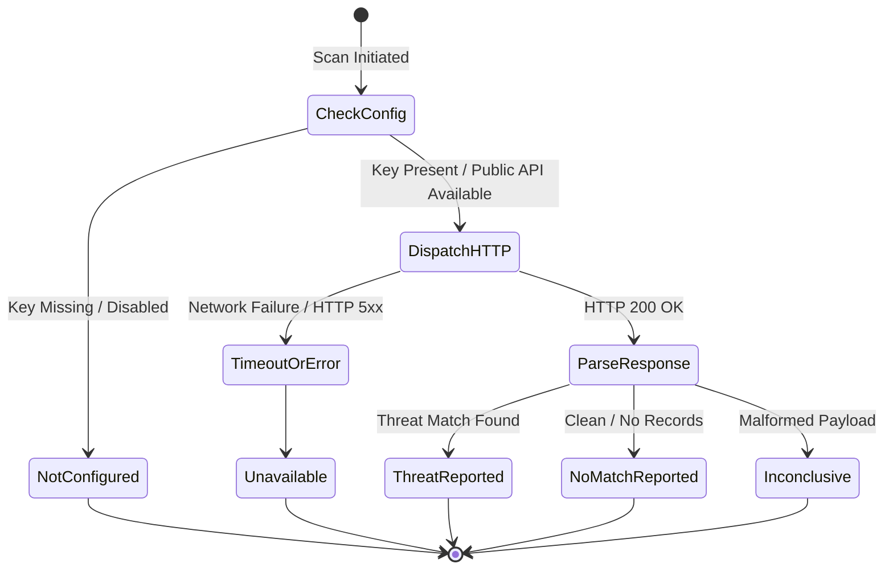

# PhishGuard AI — Threat Intelligence Integration Guide

## 1. Architectural Philosophy & Independence
PhishGuard AI enforces a strict architectural boundary between:
1. **Machine Learning Predictions:** Internal, offline lexical/structural classifier trained on URL features.
2. **External Threat Intelligence:** Authoritative external threat feeds queried via server-side REST APIs.
3. **Combined Assessment:** Transparent synthesis clearly communicating the evidence source.

> [!IMPORTANT]
> External Threat Intelligence providers are completely optional. PhishGuard AI operates with 100% functionality locally using the built-in Machine Learning engine if no API keys are configured.

---

## 2. Integrated Providers

### 2.1 Google Safe Browsing API v4
- **Official Documentation:** [Google Safe Browsing REST API v4](https://developers.google.com/safe-browsing/reference/rest)
- **Primary Focus:** Social engineering (Phishing), Malware, Unwanted Software.
- **Protocol:** Server-side HTTPS POST to `https://safebrowsing.googleapis.com/v4/threatMatches:find?key={API_KEY}`.
- **Environment Variable:** `GOOGLE_SAFE_BROWSING_API_KEY`.
- **Query Body Schema:**
```json
{
  "client": {
    "clientId": "phishguard-ai",
    "clientVersion": "1.0.0"
  },
  "threatInfo": {
    "threatTypes": ["MALWARE", "SOCIAL_ENGINEERING", "UNWANTED_SOFTWARE", "POTENTIALLY_HARMFUL_APPLICATION"],
    "platformTypes": ["ANY_PLATFORM"],
    "threatEntryTypes": ["URL"],
    "threatEntries": [
      {"url": "https://example-suspect.com"}
    ]
  }
}
```
- **Response Parsing:**
  - If `matches` array is non-empty: Return `Threat Reported` with `threatType`.
  - If `matches` is absent/empty: Return `No Match Reported`.
  - On timeout / HTTP 4xx/5xx: Return `Unavailable`.
  - If API key is empty/unset: Return `Not Configured`.

---

### 2.2 abuse.ch URLhaus API
- **Official Documentation:** [abuse.ch URLhaus API](https://urlhaus.abuse.ch/api/)
- **Primary Focus:** Sites actively distributing malware, botnet C2s, and malicious payloads.
- **Protocol:** Server-side HTTPS POST to `https://urlhaus-api.abuse.ch/v1/url/`.
- **Environment Variable:** `URLHAUS_AUTH_KEY` (optional; URLhaus permits public lookups with rate limits).
- **Request Parameters:**
  - Form data: `url={encoded_target_url}`.
- **Response Parsing:**
  - `query_status == "ok"`: Return `Threat Reported` with `url_status` and threat tags.
  - `query_status == "no_results"`: Return `No Match Reported`.
  - Network timeout / error: Return `Unavailable`.
  - If unset and network blocked: Return `Not Configured`.

---

## 3. Provider State Machine



---

## 4. Synthesis & Grounding Rules
- **Rule 1 (No Invalidation of ML):** A `No Match Reported` from Safe Browsing does **not** make a URL safe. Attackers create thousands of zero-day phishing links per hour that have not yet been indexed by threat feeds. The ML classification reflects structural risk even when external feeds have no record yet.
- **Rule 2 (No Artificial Math Scores):** Never add or multiply ML probabilities with threat-intel flags into a meaningless "composite risk percentage".
- **Rule 3 (Safe Degradation):** Threat provider timeouts (configured at 4.0s) never block the ML response or abort the scan.
